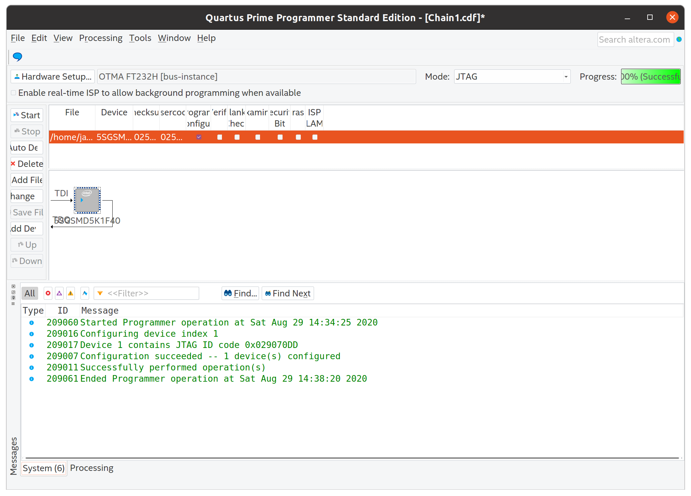

# JTAG library for FT232H on Pikes Peak / Storey Peak FPGA Boards

This driver allows using the on-board FT232 chip as a JTAG interface in Quartus for the Pikes Peak and Storey Peak FPGA accelerator boards.

## Installation

Install pre-reqs:

```sh
# On Debian/Ubuntu hosts
sudo apt-get install -y libtool pkg-config texinfo libusb-dev libusb-1.0.0-dev libftdi-dev autoconf libjim-dev git wget build-essential cmake openocd
```

Build:

```sh
git clone https://github.com/j-marjanovic/jtag-quartus-ft232h
cd jtag-quartus-ft232h
mkdir build && cd build
cmake ..
make -j`nproc`
```

To install, copy `libjtag_hw_otma.so` to your quartus `linux64` directory (eg. `$HOME/altera/15.0/quartus/linux64`).

To avoid permission errors, create an UDev rule allowing permission to the `plugdev` group and add your user to this group.

```sh
cat << EOF | sudo tee /etc/udev/rules.d/100-usb-ftdi.rules
SUBSYSTEM=="usb", ATTRS{idVendor}=="0403", ATTRS{idProduct}=="6014", OWNER="root", GROUP="plugdev", TAG+="uaccess"
EOF
```

Add your user to `plugdev` group with `sudo adduser $USER plugdev`

## Initialization

The TCK rate is taken from Quartus: the Programmer exposes it as the `JtagClock` hardware parameter (the "Clock frequency" box in the Programmer's Hardware Settings, stored in the Quartus settings under `PGMWQ_TCK_FREQ`) and passes it to the driver in Hz.
The driver programs the MPSSE divider from that value and reports the rate it actually achieved back to Quartus.
If the Programmer never sets it, the adapter runs at 30 MHz, the fastest the FT232H's MPSSE can generate and the rate verified on the Storey Peak boards.

The rate can also be set from the command line:

```sh
jtagconfig --setparam "OTMA FT232H [otma-1:4]" JtagClock 6M
jtagconfig --getparam "OTMA FT232H [otma-1:4]" JtagClock
```

## Multiple adapters

Every FT232H found on the system is presented as a separate JTAG cable, so several boards can be connected at the same time:

```
$ jtagconfig
1) OTMA FT232H [otma-1:4]
  029070DD   5SGSMD5(B|K|H|E|D)...
2) OTMA FT232H [otma-1:5]
  029070DD   5SGSMD5(B|K|H|E|D)...
```

The part in brackets is the USB bus and port path of the adapter (`bus:port`).
The on-board EEPROMs carry no serial number, so this is the only stable identity--keep the cables in the same USB ports if you rely on the names.

Select a cable by name, e.g. for `quartus_pgm`:

```sh
quartus_pgm -c "OTMA FT232H [otma-1:4]" -m jtag -o "p;top.sof"
```

Without `-c` Quartus picks the first cable it finds, which with two identical adapters is not necessarily the one you want.

## Current state

- JTAG scan chain and programming of the FPGA works (see the screenshot below)
- Initialization of the MPSSE is implemented
- Multiple FT232H adapters are supported, and each one appears as a separate cable
- Shifts are issued as bulk MPSSE commands, not one command per bit
- Smaller improvements also pending

### Download time

The following table present the bitstream download time at different clock
speeds for 5SGSMD5 with the bitstream size of 213,798,880 bits (cca 26 MB).

| Requested clock [MHz] | Actual TCK [MHz] | Download time [mm:ss] |
|-----------------------|------------------|-----------------------|
|  2                    |  2               | 01:56                 |
|  4                    |  3.75            | 01:08                 |
|  6                    |  6               | 00:45                 |
| 10                    | 10               | 00:31                 |
| 20                    | 15               | 00:24                 |
| 30                    | 30               | 00:16                 |


### Usage example

Result after programming the bitstream:



## Useful links

  * https://forums.intel.com/s/question/0D50P00003yyL2bSAE/bemicro-and-programming-under-linux ([archive.today link](http://archive.today/1iEwQ))
  * https://community.intel.com/t5/Programmable-Devices/MAX10-JTAG-Instruction-Set-Understanding-what-USBBlaster-is/td-p/218784 ([archive.today link](http://archive.today/J0Cc2))

## Dummy device

To install the library:

```sh
sudo ln -sf $(readlink -f libjtag_hw_dummy.so) /opt/intelFPGA/19.1/quartus/linux64/
```

To listen do the debug log:

```sh
nc -lkuU /var/tmp/jtag-dummy.sock
```
